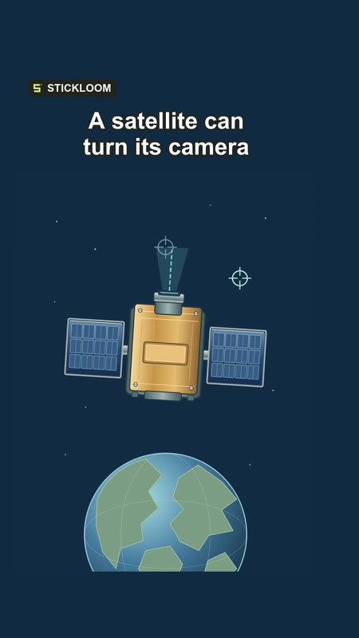
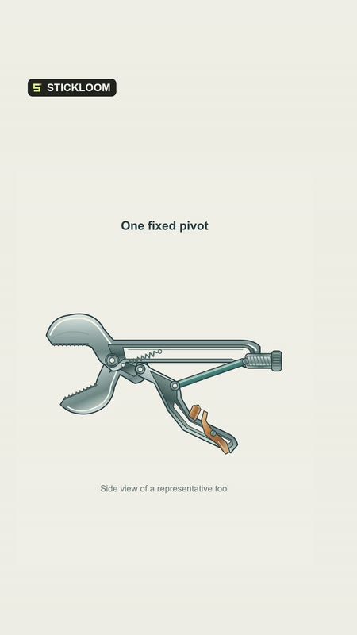
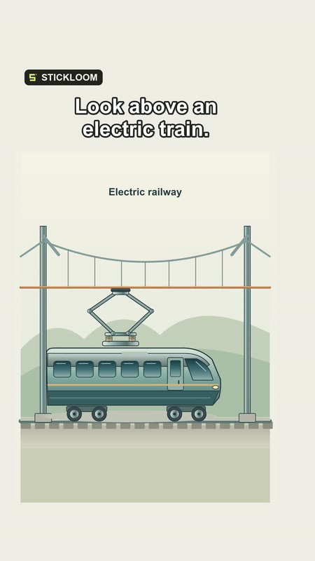
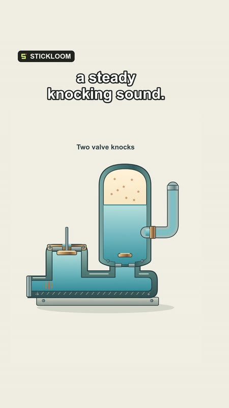
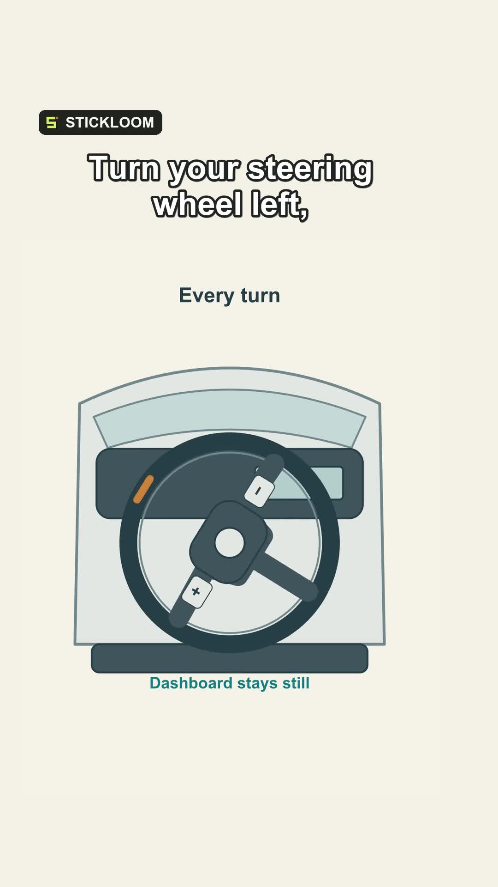
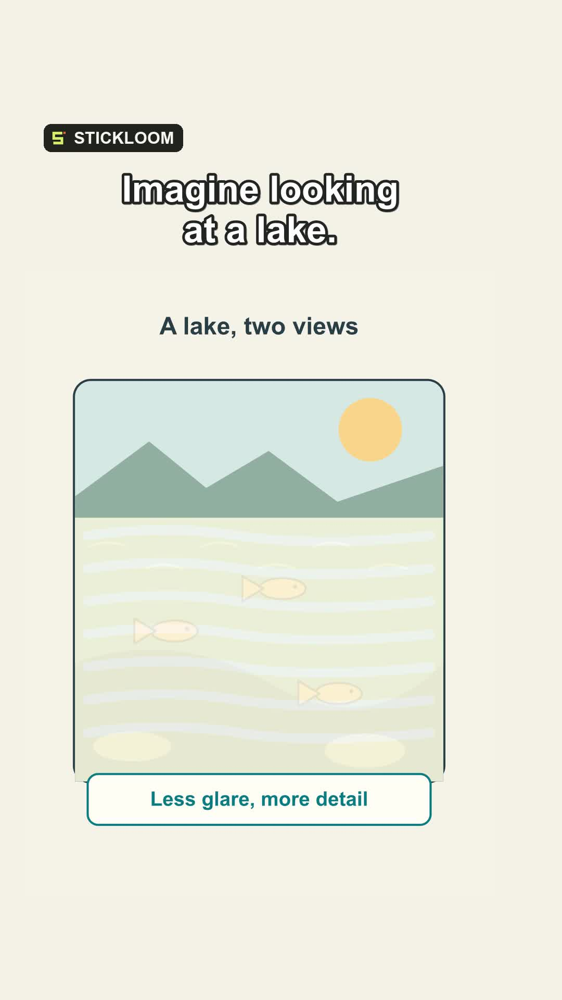
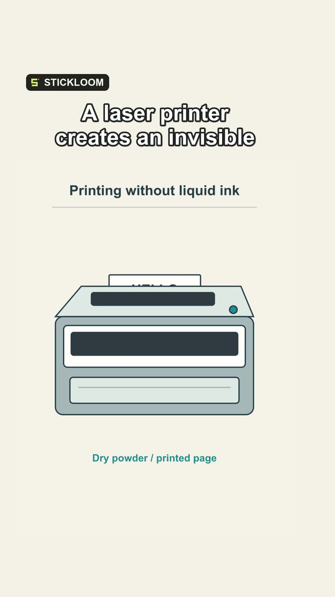
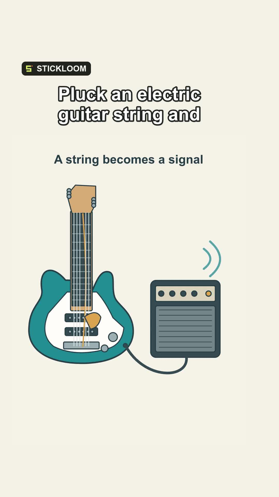
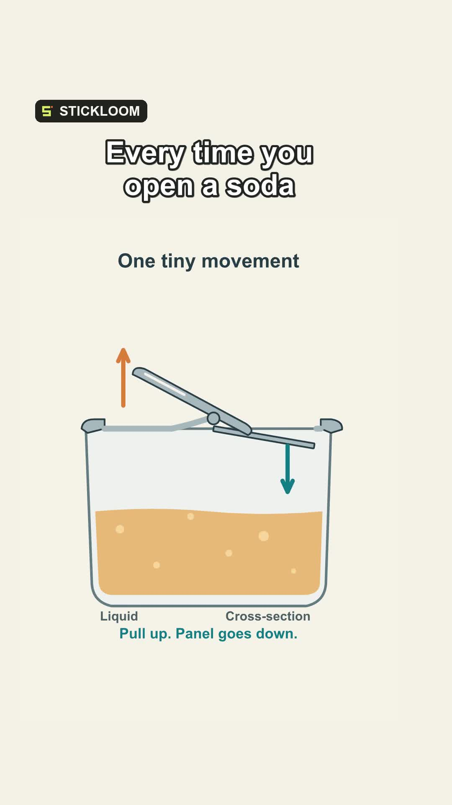
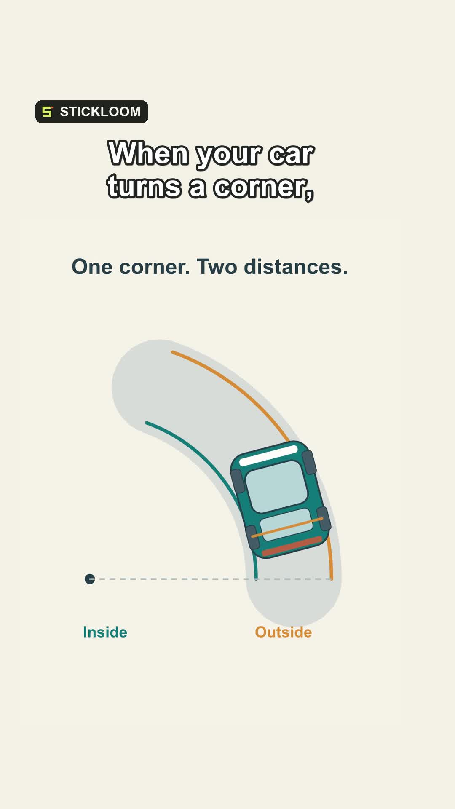

# Stickloom Studios

We make short animated films about how everyday things work. Our local animation studio uses cutaways, motion graphics, and narration to show what happens inside familiar objects, from a soda can to a satellite.

## Start with our newest renders

<table>
  <tr>
    <td align="center" valign="top">
       
      <strong>How a satellite turns without a rocket</strong> 
      <a href="https://github.com/HikariDavid/stickloom-showcase/releases/download/november-2026/satellite-turning.mp4">Download MP4 (2:23)</a>
    </td>
    <td align="center" valign="top">
       
      <strong>Why locking pliers stay clamped</strong> 
      <a href="https://github.com/HikariDavid/stickloom-showcase/releases/download/november-2026/locking-pliers.mp4">Download MP4 (1:57)</a>
    </td>
  </tr>
  <tr>
    <td align="center" valign="top">
       
      <strong>Why train power wires zigzag</strong> 
      <a href="https://github.com/HikariDavid/stickloom-showcase/releases/download/november-2026/electric-train.mp4">Download MP4 (1:59)</a>
    </td>
    <td align="center" valign="top">
       
      <strong>A water pump that needs no electricity</strong> 
      <a href="https://github.com/HikariDavid/stickloom-showcase/releases/download/november-2026/hydraulic-ram-pump.mp4">Download MP4 (1:55)</a>
    </td>
  </tr>
</table>

## Recent reels

<table>
  <tr>
    <td align="center" valign="top">
       
      <strong>Steering-wheel clock spring</strong> 
      <a href="https://www.instagram.com/reel/DgP0hBnBBqc/">Watch on Instagram</a>
    </td>
    <td align="center" valign="top">
       
      <strong>Polarized sunglasses</strong> 
      <a href="https://www.instagram.com/reel/DgQTESsBI9_/">Watch on Instagram</a>
    </td>
  </tr>
  <tr>
    <td align="center" valign="top">
       
      <strong>Laser printing without liquid ink</strong> 
      <a href="https://www.instagram.com/reel/DgPanbczIDz/">Watch on Instagram</a>
    </td>
    <td align="center" valign="top">
       
      <strong>Electric guitar pickups</strong> 
      <a href="https://www.instagram.com/reel/DgOebDDJjWy/">Watch on Instagram</a>
    </td>
  </tr>
  <tr>
    <td align="center" valign="top">
       
      <strong>How a soda can opens</strong> 
      <a href="https://www.instagram.com/reel/DgNvLB8vN9R/">Watch on Instagram</a>
    </td>
    <td align="center" valign="top">
       
      <strong>Why wheels turn at different speeds</strong> 
      <a href="https://www.instagram.com/reel/DgNCwKVxOc9/">Watch on Instagram</a>
    </td>
  </tr>
</table>

## Watch the demo

[Why Mechanical Combination Locks Need Different Turning Directions](https://www.youtube.com/watch?v=Jtqw2vJ-ih0) on YouTube

## Reels with 1,000+ views

Instagram view counts from our November 2026 screenshots.

| Reel | Instagram views |
| --- | ---: |
| [Can fear make time feel slower?](https://www.instagram.com/reel/DgHle0RAvUJ/) | 1,777 |
| [The rocks that move across a desert](https://www.instagram.com/reel/DgAy2FEkauj/) | 1,535 |
| [The strange lump on a cable](https://www.instagram.com/reel/DfsDRJmDagU/) | 1,330 |
| [How a soda can opens](https://www.instagram.com/reel/DgNvLB8vN9R/) | 1,327 |
| [The horse that fooled the scientists](https://www.instagram.com/reel/DflJ0HhGcml/) | 1,326 |
| [Why a torque wrench clicks](https://www.instagram.com/reel/DgNfCcMtU9i/) | 1,317 |
| [How two switches control one light](https://www.instagram.com/reel/DgAT0jhjJMN/) | 1,316 |
| [How a cable-free bicycle brake works](https://www.instagram.com/reel/DgBb4_vgdY7/) | 1,266 |
| [How a suction cup holds and releases](https://www.instagram.com/reel/Df_rm0PjnzE/) | 1,211 |
| [The pencil that turns its own lead](https://www.instagram.com/reel/DfschYUEm60/) | 1,117 |
| [Steering-wheel clock spring](https://www.instagram.com/reel/DgP0hBnBBqc/) | 1,047 |

[More films on Instagram](https://www.instagram.com/stickloom_studios/) · [Stickloom Studios on YouTube](https://www.youtube.com/channel/UCIWdJluZgSn-bw9zlUlG1tQ)
